# Manual de Atención al Cliente y Gestión de Pedidos — Iori Biker Shop

Este manual está dirigido al equipo de **Ventas, Atención al Cliente y Despacho**. Explica el flujo de compra coordinado por WhatsApp, el ciclo de vida de los pedidos, el control transaccional de stock y el uso de las plantillas oficiales pre-rellenadas.

---

## 1. El Flujo de Compra en Iori Biker Shop

> [!NOTE]
> La web **NO cobra automáticamente** ni tiene pasarelas de pago que descuenten dinero al cliente. Todo el cobro, validación de stock y confirmación final lo realiza un asesor humano en WhatsApp.

```mermaid
graph LR
    A[Cliente arma Carrito] --> B[Envía Pedido por WhatsApp]
    B --> C[Web registra IORI-000001]
    C --> D[Asesor valida stock en Bodega]
    D --> E[Asesor envía datos de pago / QR]
    E --> F[Cliente transfiere o yapea]
    F --> G[Asesor marca PAGADO en Admin]
    G --> H[Sistema descuenta Stock]
    H --> I[Despacho o Recojo en Tienda]
```



1. El cliente llena sus datos y toca el botón **"Enviar pedido por WhatsApp"**.
2. El servidor valida precios y stock, asigna un correlativo oficial (ej. `IORI-000005`) y abre WhatsApp con el detalle completo.
3. El mensaje llega al WhatsApp oficial de Iori Biker Shop (`+51 905 445 698`).

---

## 2. Ciclo de Vida y Estados de los Pedidos

En el panel de control (`/admin` > pestaña **"Pedidos WhatsApp"**), cada pedido pasa por los siguientes estados:

| Estado | Significado | Acción del Asesor |
| :--- | :--- | :--- |
| **Nuevo** | El pedido fue generado en la web. El cliente tiene el mensaje listo para enviar. | Si pasa más de 1 hora y el cliente no escribió, tocar botón **"Pedido sin mensaje"** para contactarlo. |
| **En Atención** | El asesor ya saludó al cliente y está validando disponibilidad física o coordinando datos. | Tocar botón **"Instrucciones de Pago"** para enviarle los montos, bancos o QR. |
| **Pagado** | El cliente envió la captura del abono y se verificó el depósito bancario. | **Al marcar Pagado**, el sistema solicitará el Método de Pago y N° de Operación, y **descontará el stock de variantes**. |
| **Despachado** | El pedido salió a delivery en Lima o fue entregado en la agencia Shalom/Marvisur. | Tocar botón **"En camino (Lima)"** o **"En camino (Provincia)"** e ingresar la guía de remisión. |
| **Entregado** | El cliente recibió su producto o lo retiró en tienda física. | Pedido completado. |
| **Cancelado** | El cliente desistió o no completó el pago. | Si el pedido ya estaba "Pagado", **el sistema devolverá automáticamente las unidades al stock**. |

---

## 3. Alerta de Pedidos Abandonados (>1 Hora en "Nuevo")

En el panel de pedidos verás pedidos resaltados con una etiqueta ámbar/roja:
> ⚠️ **"Requiere atención: >1h sin confirmar mensaje"**

Esto ocurre cuando un cliente generó su pedido en la web pero por algún motivo cerró WhatsApp antes de enviar el texto.
- **Acción recomendada**: Haz clic en el botón de WhatsApp del pedido y selecciona la plantilla oficial:
  > *"Hola, {nombre} 👋 Te escribimos de Iori Biker Shop. Registraste el pedido {codigo} en nuestra web, pero no nos llegó tu mensaje. ¿Te ayudamos a completarlo?"*

---

## 4. Cómo Confirmar un Pago y Descontar Stock

Cuando el cliente envíe su comprobante de pago:
1. Verifica en tu app del banco (BCP/BBVA) o en Yape/Plin que los fondos ingresaron realmente.
2. En el panel admin, busca el pedido por su correlativo (ej. `IORI-000005`).
3. Cambia el estado a **"Pagado"**.
4. Aparecerá un modal obligatorio solicitando:
   - **Método de Pago**: Selecciona *Yape*, *Plin*, *Transferencia BCP*, *Transferencia BBVA*, *Efectivo en Tienda* u *Otro*.
   - **Número de Operación**: Escribe los dígitos de la constancia (ej. `OP-12345678`).
5. El sistema comprobará que haya unidades suficientes en inventario:
   - Si hay stock: confirmará el pago y descontará las unidades.
   - Si no hay stock suficiente: emitirá una advertencia preventiva para que el asesor decida si forzar la venta o acordar un cambio de producto con el cliente.

---

## 5. Biblioteca de Plantillas Oficiales de WhatsApp

Todas las plantillas se encuentran precargadas en el panel para que las envíes con un solo clic:

### A. Instrucciones de Pago
```text
¡Hola, {nombre}! Gracias por tu pedido *{codigo}* 🙌 Confirmamos stock de todo. Total a pagar: *{total}*.

Puedes pagar con:
- Yape o Plin: 905 445 698 (a nombre de Iori Biker Shop)
- Transferencia BCP: cuenta 191-98765432-0-12 / CCI 002-191-009876543201-23

Te enviamos el QR en el siguiente mensaje. Cuando pagues, mándanos la captura por aquí y preparamos tu pedido.
```

### B. Pago Confirmado
```text
¡Pago recibido, {nombre}! ✅ Tu pedido *{codigo}* está confirmado y ya lo estamos preparando. Te avisamos por aquí en cuanto salga o esté listo para recoger.
```

### C. En camino (Delivery Lima)
```text
¡Tu pedido *{codigo}* ya salió, {nombre}! 🏍️ Lo entregamos en {direccion}. Te llamaremos antes de llegar.
```

### D. En camino (Provincia con Agencia)
```text
¡Tu pedido *{codigo}* ya va en camino, {nombre}! 🏍️
Agencia: {agencia}
Código de seguimiento: {codigo_seguimiento}
Destino: {ciudad}
Para recogerlo en la agencia, lleva tu DNI en físico.
```

### E. Listo para Recojo en Tienda
```text
¡Tu pedido *{codigo}* ya está listo, {nombre}! 🙌 Recógelo en nuestra tienda de {tienda} ({direccion_tienda}), {horario_tienda}. Menciona tu código de pedido al llegar.
```

### F. Producto Agotado con Alternativa
```text
Hola, {nombre}. Revisando tu pedido *{codigo}*, el producto {producto} ({variante}) se nos acaba de agotar en almacén 😕 Te podemos ofrecer una alternativa similar o continuar con el resto del pedido. ¿Cómo prefieres continuar?
```

---

## 6. Gestión del Libro de Reclamaciones

Ubicación: `/admin` > pestaña **"Otras Bandejas" > "Reclamaciones"**.

- **Normativa de Indecopi (Ley N° 29571)**:
  - Todo reclamo o queja registrado en `/libro-de-reclamaciones` genera un código oficial (ej. `REC-2026-000001`).
  - El plazo legal improrrogable para responder formalmente es de **máximo 15 días hábiles**.
- **Registro de la Respuesta**:
  1. Abre el detalle de la hoja de reclamación en la bandeja.
  2. Lee los hechos relatados y el pedido concreto del consumidor.
  3. Haz clic en **"+ Registrar Respuesta Formal"**.
  4. Redacta la solución ofrecida o descargo técnico de la empresa.
  5. Haz clic en **"Guardar y Marcar Atendido"**.
  6. Utiliza el botón **"WhatsApp Consumidor"** para notificarle la respuesta al cliente.
